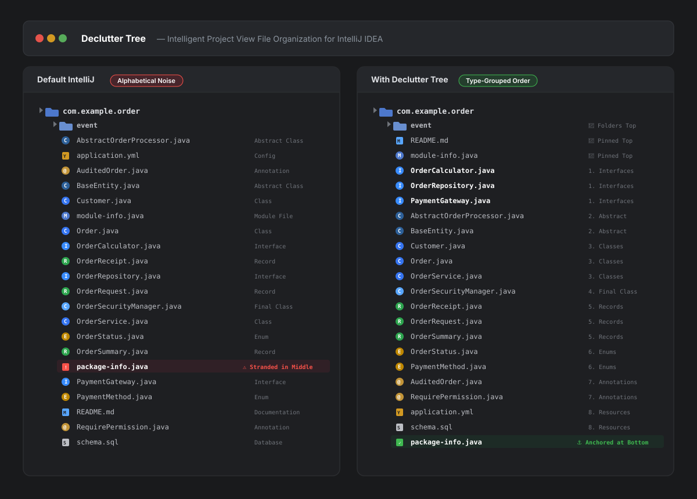

# Declutter Tree

Intelligent Project View file organization for IntelliJ IDEA. Groups code files by declaration type and lets you anchor specific files to the top or bottom of directories.

---

## Visual Comparison



---

## Overview

In standard IntelliJ IDEA projects, files are sorted strictly alphabetically. Auxiliary documentation files like `package-info.java` often sit in the middle of domain logic, while interfaces, entities, records, and enums are mixed together purely by name.

Declutter Tree provides a clean, predictable sorting hierarchy:
1. **Directories on top:** Folder structure remains untouched at the top of the directory.
2. **Top file anchoring:** Pin high-priority files (like `README.md` or `module-info.java`) directly beneath folders, above code files.
3. **Type-based grouping:** Java and Kotlin files are grouped by declaration kind:
   - Interfaces
   - Abstract Classes
   - Classes
   - Final Classes
   - Records
   - Enums
   - Annotations
4. **Alphabetical sorting:** Elements within each group remain sorted A-Z.
5. **Bottom file anchoring:** Auxiliary files like `package-info.java` are pushed to the very bottom.
6. **Configurable settings:** Custom top files, bottom files, and type grouping can be customized in `Settings -> Appearance & Behavior -> Declutter Tree`.

---

## Visual Example

### Default IntelliJ Sorting
```text
com.example.order/
├── event/
├── AbstractOrderProcessor.java   (Abstract Class)
├── application.yml               (Config)
├── AuditedOrder.java             (Annotation)
├── BaseEntity.java               (Abstract Class)
├── Customer.java                 (Class)
├── module-info.java              (Module File)
├── Order.java                    (Class)
├── OrderCalculator.java          (Interface)
├── OrderReceipt.java             (Record)
├── OrderRepository.java          (Interface)
├── OrderRequest.java             (Record)
├── OrderSecurityManager.java     (Final Class)
├── OrderService.java             (Class)
├── OrderStatus.java              (Enum)
├── OrderSummary.java             (Record)
├── package-info.java             ⚠️ (Metadata stranded in the middle!)
├── PaymentGateway.java           (Interface)
├── PaymentMethod.java            (Enum)
├── README.md                     (Markdown)
├── RequirePermission.java        (Annotation)
└── schema.sql                    (Database)
```

### With Declutter Tree
```text
com.example.order/
├── event/                        (📁 Folders on top)
├── README.md                     (📌 Pinned Top Files)
├── module-info.java
├── OrderCalculator.java          (1. Interfaces)
├── OrderRepository.java
├── PaymentGateway.java
├── AbstractOrderProcessor.java   (2. Abstract Classes)
├── BaseEntity.java
├── Customer.java                 (3. Classes)
├── Order.java
├── OrderService.java
├── OrderSecurityManager.java     (4. Final Classes)
├── OrderReceipt.java             (5. Records)
├── OrderRequest.java
├── OrderSummary.java
├── OrderStatus.java              (6. Enums)
├── PaymentMethod.java
├── AuditedOrder.java             (7. Annotations)
├── RequirePermission.java
├── application.yml               (8. Resources / Config)
├── schema.sql
└── package-info.java             (⚓ Pinned to Bottom)
```

---

## Demo Project

A complete, believable enterprise Java demo project is included in the repository at [`demo-project/`](demo-project).

You can open it directly in IntelliJ IDEA or run it in the plugin development sandbox:
```bash
./gradlew runIde
```
Then open `demo-project/` to see the live before and after comparison in IntelliJ IDEA's Project View.

---

## Performance Considerations

Because this logic runs inside the Project Tool Window tree rendering loop, the plugin is built for minimal overhead:

- **Fast-path evaluation:** Scans children in memory first. Folders without matching files return the original collection immediately without extra object allocations.
- **Stub-based type resolution:** Reads Java declaration kinds using compiled index stubs (`PsiJavaFile.classes`), avoiding full AST parsing or disk reads during tree rendering.
- **DumbAware:** Runs smoothly during background project indexing without blocking the UI.
- **Tree state preservation:** Extends standard `PsiFileNode` and delegates equality checks to the underlying `PsiFile`. File selection, Git status colors, bookmarks, and breadcrumbs function normally.

---

## Installation

### From JetBrains Marketplace
Search for **Declutter Tree** in `Settings -> Plugins -> Marketplace` and click **Install**.

### From Disk (.zip)
1. Download `declutter-tree-intellij-x.x.x.zip` from [Releases](https://github.com/vin51435/declutter-tree-intellij/releases).
2. In IntelliJ IDEA, go to `Settings (Ctrl+Alt+S) -> Plugins`.
3. Click the gear icon next to "Installed" and select **Install Plugin from Disk...**.
4. Choose the zip file and restart the IDE.

---

## Development

### Requirements
- Java 21 LTS
- IntelliJ IDEA (2024.2+ or 2025.x)

### Commands
```bash
# Clone the repository
git clone https://github.com/vin51435/declutter-tree-intellij.git
cd declutter-tree-intellij

# Run unit tests
./gradlew test

# Run isolated sandbox IDE with the plugin installed
./gradlew runIde

# Build the distributable plugin ZIP
./gradlew buildPlugin
```

The output zip will be placed in `build/distributions/`.

---

## Security and Governance

This repository uses GitHub Code Owners (`.github/CODEOWNERS`):
- All pull requests modifying build scripts, plugin descriptors, or workflows require review from [@vin51435](https://github.com/vin51435).
- GitHub Actions CI checks build health, runs unit tests, and validates plugin compatibility against IntelliJ platform APIs on every push and PR.

---

## License

Apache License 2.0. Copyright (c) Vin (https://github.com/vin51435).
